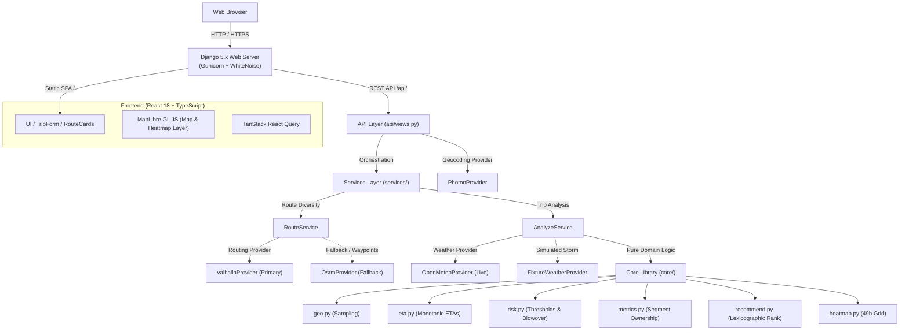

# Architecture

## System Diagram



## Architectural Layers

- **`frontend/`**: Single-page application built with React 18, Vite, TypeScript, and MapLibre GL JS. State is orchestrated via `TripContext` and TanStack Query. It manages trip form inputs, displays route cards with risk badges, shows checkpoint weather details, and renders a smooth 60fps 0–48h heatmap scrub slider without network requests on slider ticks.
- **`backend/api/`**: Django REST Framework controllers (`views.py`, `serializers.py`, `urls.py`). Validates request payloads with `AnalyzeRequestSerializer`, translates domain exceptions into standard HTTP status codes (`400`, `422`, `502`), and provides endpoints for healthchecks, typeahead geocoding, and route analysis.
- **`backend/services/`**: Application orchestration layer. `RouteService` queries primary and fallback routing engines, detects route geometry overlaps, and ensures diversity. `AnalyzeService` orchestrates the complete analysis pipeline across routing, weather batching, risk classification, and heatmap generation.
- **`backend/providers/`**: Pluggable adapter layer conforming to interfaces defined in `base.py`. Encapsulates external HTTP communication, header management, rate-limiting backoff, coordinate grid deduplication, and fallback strategies for Valhalla, OSRM, Open-Meteo, and Photon.
- **`backend/core/`**: Zero-dependency pure Python domain library. Completely isolated from Django and HTTP concerns. Implements haversine geometry, checkpoint sampling, monotonic ETA calculation, weather interpolation, risk scoring rules, truck load blowover logic, segment distance weighting, route ranking, and corridor heatmaps.

## Request Flow: `POST /api/analyze/`

1. **Validation (`api/views.py`)**: `AnalyzeRequestSerializer` validates `origin`, `destination`, future `departure_time` (within tolerance), positive `load_weight_lb`, and `checkpoint_interval_miles`.
2. **Routing Diversity (`services/routes.py`)**: `RouteService.get_diverse_routes()` queries `ValhallaProvider` with truck costing. If unavailable, falls back to `OsrmProvider`. If fewer than 3 unique routes return, perturbed waypoints generate diverse alternates. Geometries overlapping >90% within 5 miles are pruned.
3. **Checkpoint Sampling (`core/geo.py`)**: `sample_checkpoints()` walks route coordinates, sampling at intervals (10, 25, 50 mi) or dynamically via `auto_interval_miles()` (`<150 mi -> 10`, `150-500 mi -> 25`, `>500 mi -> 50`). Start and end coordinates are always preserved.
4. **ETA Calculation (`core/eta.py`)**: `compute_checkpoints_eta()` assigns strictly monotonic arrival times along the route's distance profile, anchored to `departure_time` and total transit duration.
5. **Weather Retrieval (`providers/open_meteo.py`)**: Coordinates along routes and corridor grid are rounded to 0.1° (~11 km) to deduplicate locations. Coordinates missing from cache are queried in batches of ≤50 across 5 concurrent worker threads. In `WEATHER_MODE=fixture`, `FixtureWeatherProvider` substitutes real queries with a deterministic winter storm.
6. **Temporal Interpolation (`core/weather_interp.py`)**: `interpolate_weather_at_time()` linearly interpolates hourly forecast metrics (wind, gusts, rain, snow) to match each checkpoint's exact fractional-hour ETA.
7. **Risk Classification (`core/risk.py`)**: `classify_checkpoint_risk()` evaluates wind, precipitation, and commercial cargo blowover rules (`apply_load_rules()`), assigning levels (`LOW` to `NO_TRAVEL`) and primary drivers.
8. **Segment Ownership & Metrics (`core/metrics.py`)**: `compute_route_metrics()` calculates midpoint Voronoi segment ownership for each checkpoint so owned segment sums equal total route mileage. Computes total `no_travel_miles`, `severe_miles`, `high_miles`, and distance-weighted `avg_risk`.
9. **Recommendation Ranking (`core/recommend.py`)**: `rank_and_recommend()` sorts routes lexicographically by `(no_travel_miles, severe_miles, high_miles, avg_risk, duration_seconds)`, assigns rank, and generates human-readable reasons and advisories.
10. **Corridor Heatmap (`core/heatmap.py`)**: `build_corridor_heatmap()` samples points spaced 10 miles along route corridors and pre-calculates 49 hours of risk levels (T+0 to T+48).

## Directory Structure

```
backend/
├── api/             # DRF views, serializers, URL routing
├── config/          # Django settings, WSGI, WhiteNoise static configuration
├── core/            # Pure Python business logic: risk, geo, eta, metrics, ranking, heatmap
├── fixtures/        # Recorded JSON payloads for offline testing and deterministic storm
├── providers/       # HTTP adapters: Valhalla, OSRM, Open-Meteo, Photon
├── services/        # Orchestration layer: RouteService, AnalyzeService
└── tests/           # Pytest test suite (111 unit, integration, and contract tests)
frontend/
├── src/
│   ├── api/         # Fetch client with mock mode toggle and backend bindings
│   ├── components/  # Layout, Header, Provider attribution banners
│   ├── context/     # TripContext managing global state and analysis responses
│   ├── features/    # Map, Heatmap slider, TripForm, RouteCards, Checkpoints
│   ├── mocks/       # Recorded Chicago -> Denver sample payload
│   └── test/        # Vitest test suite for risk utilities, validation, and slider
```
